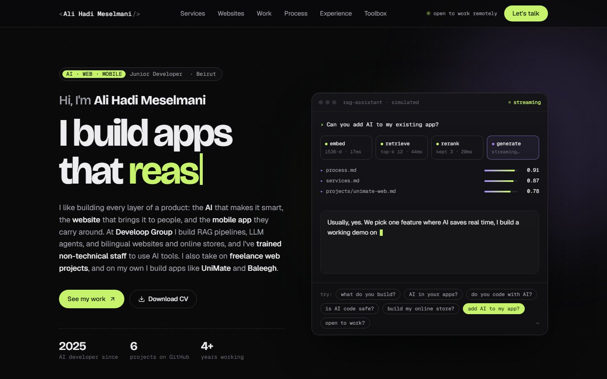
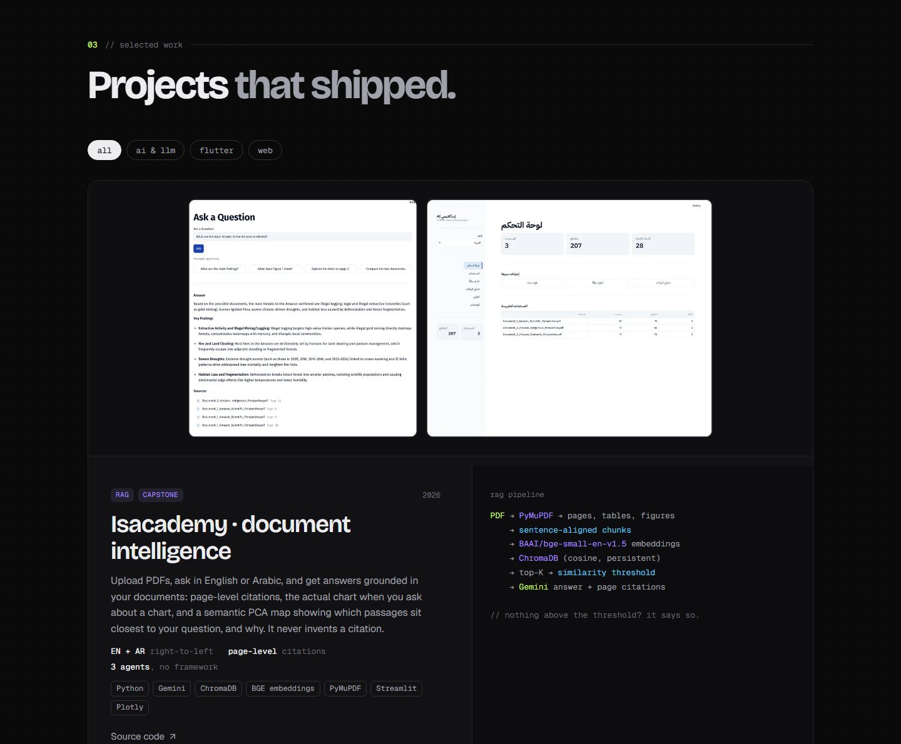
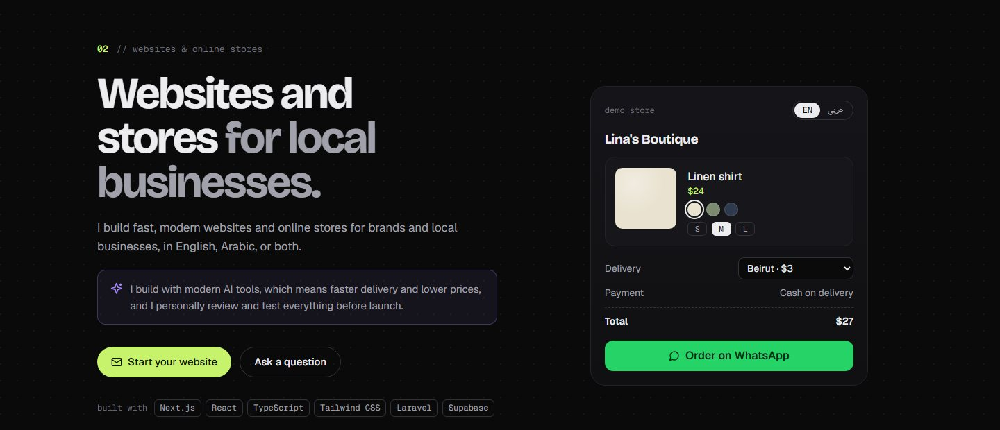
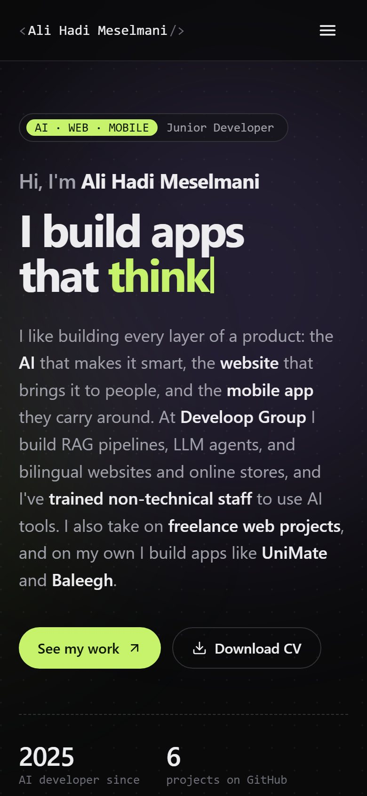
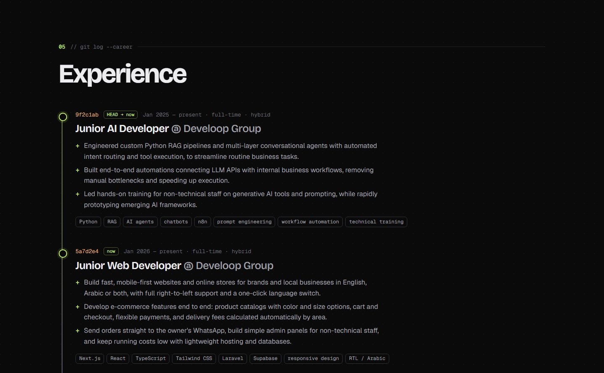

# Ali Hadi Meselmani · Portfolio

**Live site: [ali-hadi-meselmani.vercel.app](https://ali-hadi-meselmani.vercel.app)** · in Arabic: [/ar/](https://ali-hadi-meselmani.vercel.app/ar/)



Personal portfolio of a junior **AI, web and mobile developer** in Beirut: RAG pipelines and LLM agents, bilingual websites and online stores, and Flutter apps.

## What's inside

- **Simulated RAG assistant** in the hero: each question walks through *embed → retrieve → rerank → generate* and streams a scripted answer, with the "retrieved sources" and their scores. It is clearly labelled as simulated.
- **Websites & online stores** section with a working **demo store**: switch between English and Arabic (full right-to-left), pick a color and size, and see the delivery fee change by area.
- **Projects** with real screenshots, a filter (AI & LLM / Flutter / Web), and a **"More on GitHub"** list that loads my public repositories live from the GitHub API, so new repos appear without editing the page (only repos with a description; the list hides itself when there are none).
- **Experience** styled as a `git log`, plus certifications and community events.
- **Arabic version** at `/ar/`: the whole site in Arabic, right to left, with an EN | عربي switch in the header.
- **Link preview card** (Open Graph / Twitter), structured data for search engines, `robots.txt` and `sitemap.xml`.

## Screenshots

| Projects | Demo store (EN ⇄ AR) | Mobile |
|---|---|---|
|  |  |  |



## Built with

Plain **HTML, CSS and JavaScript**: no framework and no build step. Everything the site serves is in `public/`.

- Fonts: Bricolage Grotesque, Geist, Geist Mono and IBM Plex Sans Arabic, self-hosted in `public/assets/fonts/` (SIL Open Font License)
- Icons: [Lucide](https://lucide.dev) (ISC License), inlined as SVG
- Hosting: [Vercel](https://vercel.com), deployed with the Vercel CLI; it publishes only the `public/` folder

## Run it locally

```bash
python -m http.server 5500 --directory public
```

Then open <http://localhost:5500> (Arabic: <http://localhost:5500/ar/>). A local server behaves like the live site. Opening `public/index.html` directly also works, but the Arabic page and the 404 page need the server: their links to the shared files start with `/`.

## Project structure

```
public/                         everything the website serves (nothing outside it is published)
  index.html                    English page
  ar/index.html                 the same page in Arabic (right to left); change both pages together
  404.html                      page shown for addresses that don't exist (English and Arabic)
  Ali_Hadi_Meselmani_CV.pdf     downloadable CV
  favicon.ico                   the "A/" icon for browsers and crawlers
  apple-touch-icon.png          the same icon for iPhone home screens
  robots.txt, sitemap.xml       rules and page list for search engines
  assets/
    css/styles.css              all styles, including the font setup
    js/script.js                demo, store, filters, GitHub list, menu and scroll effects (English and Arabic text)
    fonts/                      self-hosted web fonts; browsers keep them a year, so give a changed font a new filename
    img/                        project screenshots and the link preview image (og.jpg); browsers keep them a week
docs/screenshots/               images used in this README (not published)
vercel.json                     publishes public/, redirects old /cv.pdf and /img/ links, sets browser caching
.gitignore, .vercelignore       keep local files out of git and out of deploys
```

## Contact

[meselmanialihadi@gmail.com](mailto:meselmanialihadi@gmail.com) · [LinkedIn](https://www.linkedin.com/in/alihadimeselmani/) · [GitHub](https://github.com/AliHadi315)

---

© Ali Hadi Meselmani. The site's text, CV and screenshots are personal content; please don't reuse them without asking.
